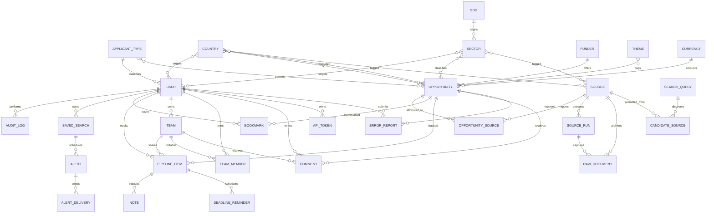

# Phase 5 data model

This diagram includes the active Phase 5 account, alert, bookmark, and personal pipeline relationships. Team workflows and the public API remain future work.

`OpportunitySource` is the explicit through model for opportunity/source attribution. The configured user model is `accounts.User`. Countries, currencies, and taxonomies are populated with `seed_reference_data`; monitored sources are loaded from `sources.yaml`.
