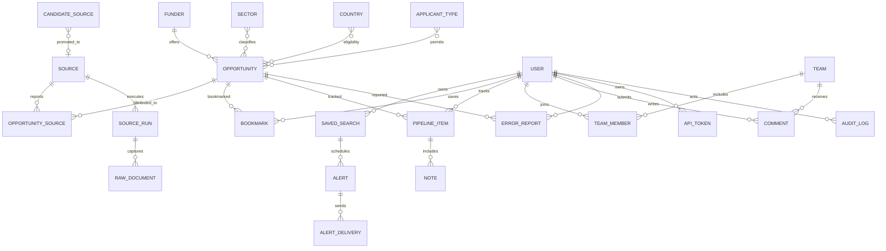

# Initial data model (planned)

This Phase 0 diagram records the intended domain relationships. It is not a schema contract: fields, constraints, and deletion policies will be specified and tested when the models are implemented in Phase 1.

`User` refers to Django's configured user model. Many-to-many relationships shown above will use explicit through models where metadata or auditability is required.
